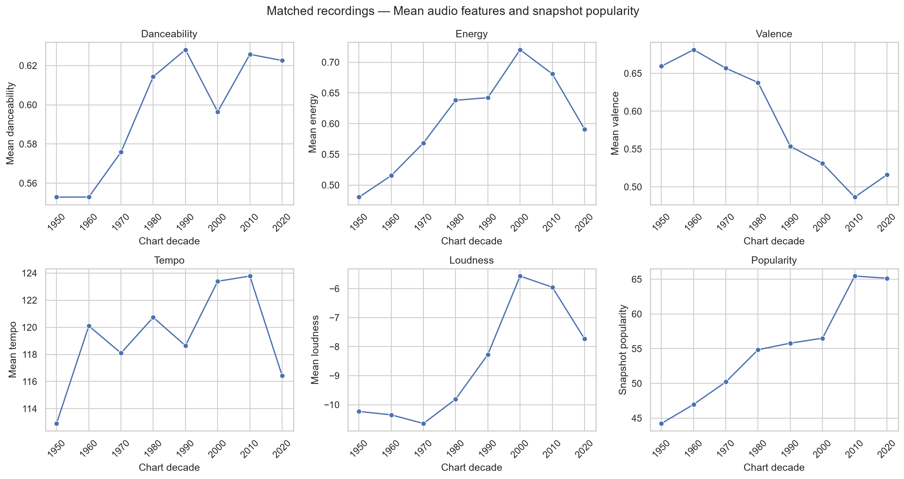
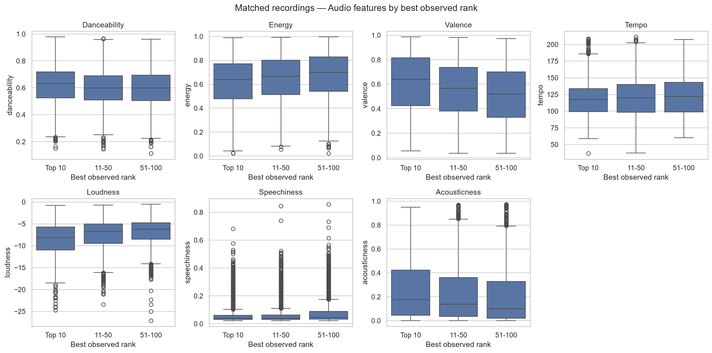

# Spotify Audio Features × Billboard Hot 100

An exploratory data analysis of Spotify audio features and Billboard Hot 100 chart appearances. The project examines the songs that can be matched across the two sources, with coverage checks and one-recording analysis units.

## Questions

1. How do audio features differ across chart decades in the matched sample?
2. Do recordings reaching the Top 10 differ from those peaking at 51–100?
3. Which genre labels are most common, and how do their average features differ?
4. Which recordings combine low valence with high snapshot popularity, or a slow tempo with a Top 10 peak?

## Key findings

<!-- RESULTS_START -->
- Matched **6,922/31,327** unique song–artist keys (**22.1%**).
- Top 10 minus 51–100 median energy: **-0.060** (descriptive difference).
- Most represented matched genre: **Country**, with **1090.0** weighted recordings.




<!-- RESULTS_END -->

In the saved analysis, the Top 10 and 51–100 groups contain **1,980** and **2,207** recordings, respectively. A negative median-energy difference means the Top 10 median is lower. This is a descriptive comparison; no statistical-significance test was performed.

Genre labels come from the Spotify dataset. A recording with two labels contributes 0.5 to each, so the genre totals are fractional counts rather than counts of distinct recordings in mutually exclusive genres.

## Run locally with Anaconda / Jupyter

Use Python 3.10 or newer. Download or clone the complete project, then open Anaconda Prompt or a terminal in its root folder:

```bash
conda create -n spotify python=3.11 pip
conda activate spotify
python -m pip install -r requirements.txt
jupyter lab
```

Before **Run All**, download the two CSVs from the [original sources](#data-sources) into `data/` using the steps below. This is the recommended route; Drive mirrors are an optional fallback.

Start Jupyter from the activated `spotify` environment, open [notebooks/analysis.ipynb](notebooks/analysis.ipynb), and select **Run → Run All Cells**. Save the notebook afterward to retain its tables and plots.

The notebook works when Jupyter starts in either the project root or the notebooks folder. Keep the src folder alongside notebooks; downloading the notebook alone is insufficient. No Colab account or system unzip command is needed.

For later sessions, activate the spotify environment and launch JupyterLab from the project folder.

## Project files

| Path | Purpose |
| --- | --- |
| notebooks/analysis.ipynb | Questions, exploratory analysis, static plots and calculated Key findings |
| src/data_loader.py | Local CSV reuse, cached ZIP reading and optional Drive fallback |
| src/cleaning.py | Spotify feature validation, popularity aggregation and chart-row cleaning |
| src/matching.py | Text normalization and conservative song–artist matching |
| data/ | Generated local data folder; excluded from Git |
| figures/ | Generated decade-trend and rank-comparison PNGs; include them in GitHub |
| requirements.txt | Analysis packages and JupyterLab |
| LICENSE | MIT license for the project code |

## Data sources

| Input | Original source | License reference |
| --- | --- | --- |
| SpotifyFeatures.csv | [Spotify Tracks DB — Zaheen Hamidani, Kaggle](https://www.kaggle.com/datasets/zaheenhamidani/ultimate-spotify-tracks-db) | License listed on Kaggle: Unknown. Used here for educational analysis only; the data is not redistributed in this repository. |
| hot-100-current.csv | [UT Data Billboard archive](https://github.com/utdata/rwd-billboard-data) | Repository code: [MIT](https://github.com/utdata/rwd-billboard-data/blob/main/LICENSE); check upstream terms for chart data. |

### Download from the original sources

1. Create a `data/` folder in the project root, alongside `notebooks/` and `src/`.
2. **Spotify:** Open the [Kaggle dataset page](https://www.kaggle.com/datasets/zaheenhamidani/ultimate-spotify-tracks-db), sign in if required, and download the dataset. Extract the archive and copy `SpotifyFeatures.csv` into `data/`.
3. **Billboard:** open UT Data's [hot-100-current.csv](https://github.com/utdata/rwd-billboard-data/blob/main/data-out/hot-100-current.csv), select **Download raw file**, and save it as `data/hot-100-current.csv`.
4. Keep these exact filenames, then run `notebooks/analysis.ipynb`. When both CSVs are present, the loader reuses them without downloading anything.

The saved findings use a Billboard snapshot through **2024-06-08**. Current upstream releases may contain newer data and produce different results.

### Optional Drive fallback

Use the original-source downloads above first. If they are temporarily unavailable and upstream terms permit using the mirrored copies, these existing links are a last-resort fallback:

- [Spotify archive](https://drive.google.com/file/d/1KvG1T9rL6gOqmOO-VDOpO4PhKUdFU2Lh/view)
- [Hot 100 archive](https://drive.google.com/file/d/1iqefQOCEMdTs4lKZTguRexnGYi0TWCHO/view)

The loader checks for local CSVs first, then reuses valid cached ZIPs. If an input is still missing, it automatically tries its Drive mirror. To use the recommended original-source route, place both CSVs in `data/` before running the notebook.

Drive mirrors depend on public access and quota and may stop working. If a mirror fails, use the original-source steps above and rerun the loading cell. Mirrored snapshots may differ from current upstream releases.

Raw CSVs and source archives are not included in the repository.

## Analysis and results

See the notebook for coverage by chart decade, the full feature and rank-group comparisons, and the thresholds behind these descriptive findings.

## Interpretation limits

- Results describe only the matched subset. Unmatched songs can reflect recordings absent from the Spotify sample, differences in song titles or artist credits, or ambiguous identities excluded by the matching rules; these reasons were not separately quantified.
- Because only about 22% of Hot 100 song–artist keys were matched, the matched sample may not be representative of the full chart; findings may be biased toward recordings that are present in the Spotify dataset.
- Coverage varies by chart decade. In the saved run, only **61/3,024 (2.0%)** song–artist keys matched for the 2020s. This decade is weakly represented and should not be treated as representative of all its Hot 100 songs.
- Chart decade means chart presence, not release date. The 1950s cover only 1958–59, and boundary decades can be incomplete.
- Matching preserves full artist credits, accents and version words. Ambiguous Spotify identities are excluded, and differently credited collaborations can remain unmatched. Matching names does not verify historical recording versions.
- Popularity is averaged across available source rows per track ID before genre deduplication. It summarizes undated snapshot values, rather than historical chart success or a necessarily current single-date score. Other track-level fields retain the first row.
- Recordings contribute once per chart decade to trends and once overall to best-rank comparisons. Multi-genre recordings contribute fractional weights totaling one to matched genre summaries.
- Valence measures musical positiveness, not listener mood. Plots, median differences and threshold examples are descriptive; they do not establish causes or statistical significance.

## License

The project code is released under the [MIT License](LICENSE). Datasets remain subject to their original terms; this license does not relicense the Spotify or Billboard data.
